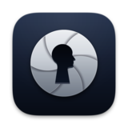
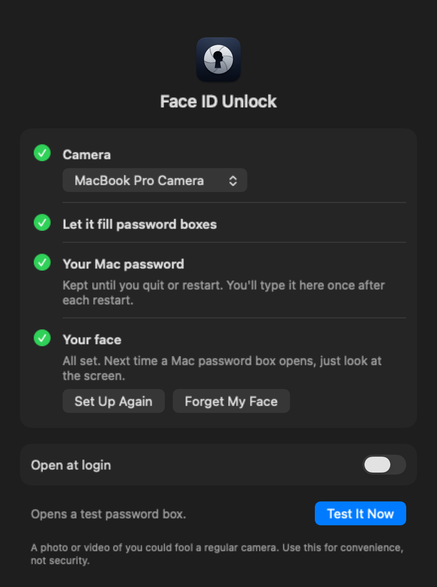

<p align="center"></p>

<h1 align="center">Face ID Unlock</h1>

<p align="center"><b>Look at the camera, and it types your Mac password in for you.</b><br>
A free menu-bar app for Macs with no Touch ID in reach. Nothing leaves your Mac.</p>

<p align="center"></p>

System Settings wants your password. Then an installer, then the Passwords app, then a keychain prompt.
Each time, you reach for the keyboard and type the same password again.

Touch ID covers many of these boxes, but only when it's under your hand. On some desks it never is:

- A [Mac mini](https://www.apple.com/mac-mini/specs/) or [Mac Studio](https://www.apple.com/mac-studio/specs/). Neither comes with a keyboard.
- A MacBook docked with the lid shut.
- A custom or mechanical keyboard. Apple [doesn't sell Touch ID on its own](https://www.jeffgeerling.com/blog/2025/why-doesnt-apple-make-standalone-touch-id/).

The last one is me, so I built this.

It works with the Mac's built-in camera, a Studio Display or a webcam. On my Mac the password is in
about two seconds after the box appears, about three on boxes that ask you to look left or right. In System Settings and on the Passwords lock screen it finishes the job. Every other box waits
for your click, because any program can raise one.

## Get started

Releases are signed and notarized (checked by Apple's malware scan), so macOS opens the app without a
warning. Get it only from this repo. It's tested on macOS 27.

1. Download the zip from the [latest release](https://github.com/timharris707/faceidunlock/releases/latest), unzip it, and move
   **Face ID Unlock** to the Applications folder in your home folder.
2. Open it. Its icon appears in the menu bar, not the Dock, and Settings opens on the
   [four steps](#the-four-steps) below. They take about a minute.
3. Click **Test It Now** to watch it fill a real password box.

## Is it safe?

It's a convenience, not extra security, and it's less safe than Face ID on an iPhone. I built it for a
desk where nobody is likely to try logging in as you. Apple has nothing to do with it.

**Your password and face stay here.** The app makes no network connections. Your password stays in
memory until you restart, log out or quit, and is never written to disk. Your face is saved in your
login keychain as numbers, not a picture. Forget My Face in Settings deletes it. The app never saves a
camera picture from a real password box.

**Two permissions.** The camera, on only while the app is looking for you, setting up your face or
showing the camera you picked. And Device Control and Data Access (Accessibility on older macOS), so it
can read the password box and type into it. That one reaches every window, so it's a lot to grant. The
app uses it only to find and fill password boxes in Apple's own programs, which it checks are signed by
Apple, and fills none while someone is connected by Screen Sharing.

**It can be fooled.** A Mac camera can't see depth, so admin prompts, keychain prompts and the Passwords
lock screen also ask you to look left or right, picked at random. A photo or a recording can't know which
way. Three misses in a row pause the app until you type your password in Settings. Clips of you turning
both ways, a live deepfake or a 3D mask could still get past it, and System Settings boxes and the
general Touch ID box skip the look left or right. Other software running under your account could also
change the app's settings. [What it checks](#harder-to-fool).

The login and lock screen, FileVault, `sudo`, App Store and Apple Account passwords, and Apple Pay are
out of its reach. Typing your password always still works.

## The four steps

1. **Camera.** Click Allow Camera and allow it. With more than one camera, pick the one in
   front of you; picking one shows what it sees.
2. **Let it fill password boxes.** Click Open System Settings and, in the window that opens, turn on
   Face ID Unlock (on macOS 27 it is under Device Control and Data Access).
3. **Your Mac password.** Type it once and click Save. The app checks it against your account
   right away. It stays in memory until you restart, log out or quit, or set up or forget your face;
   it is never written to disk.
4. **Your face.** Click Set Up My Face (it works once the camera is allowed), look at the screen,
   then turn your head slowly a little left and right. It takes a few seconds; Cancel stops it and
   saves nothing. Your face is saved in your login keychain on this Mac.

"Open at login" is off until you turn it on.

<p align="center"></p>

## Everyday use

When a password box opens, a small bar at the top of the screen says "Looking for you…". Look straight
at the camera, as you would with Face ID on an iPhone; a face turned toward another screen doesn't
match. When it recognizes you it fills the box and says "Password filled. Click OK or Allow." If it
doesn't, it says "Didn't recognize you" with a Try Again button. If the box shows Touch ID, the app
clicks "Use Password…" for you first.

<p align="center"></p>

Admin prompts ("… wants to make changes"), keychain prompts and the Passwords app's lock screen ask
for one more step once it recognizes you: the bar says "Look left" or "Look right", picked at random
each time, on every screen so you can read it while still facing the camera. Turn your head a little
that way and the box is filled. Turning the other way first, a
second face, or no turn within 3 seconds shows "Didn't recognize you" and counts as a miss: a photo
or video of you can't know which way it will ask.

Two boxes only ever appear because you did something in an Apple app, so the app finishes them for
you once the whole password is in: System Settings' password box (it clicks Unlock or Modify Settings)
and the Passwords app's lock screen (it presses Return, only while Passwords is in front). Boxes any
program can raise, such as "… wants to make changes", keychain prompts and the general Touch ID box,
always wait for your own click.

## Harder to fool

Each check needs three camera frames that match your saved face closely, and a small detector turns
away anything that looks like a printed photo or a screen. The look left or right above is the check
a photo or a recording can't pass.

After 3 tries in a row that see a face that isn't yours, a face that looks like a photo or a
screen, or a look the wrong way, the app stops filling until you type your Mac password in Settings. Closing the box part-way through a try still counts. Tries where it
sees no face don't count, and a match starts the count again. Quitting doesn't reset it. While it is paused, a password box gets no camera, just
"Face ID Unlock is paused" with the reason and a Turn Back On button (it opens Settings), until the box
closes. Settings shows the reason in a banner at the top.

It also pauses the same way when a camera appears that wasn't connected when you set up your face
(a camera that comes and goes, like your iPhone, is fine once it has been seen). It never fills a
box while someone is connected with Screen Sharing or Remote Management.

## Menu bar and score log

The menu bar icon shows Ready, Paused, Paused after 3 misses, Needs setup or Needs your password,
with Pause (Turn Back On… while it has paused itself), Settings… and Quit. Hold Option for Show Score Log, Forget My Face and Home Test….

The app keeps a local log of match scores (numbers only, no images) in
`~/Library/Application Support/Face ID Unlock/scores.jsonl`, used to tune how close a match
must be. It also records when Face ID Unlock paused or resumed, whether Portrait, Studio Light or
Center Stage was on during each check, and for the look left or right which way it asked, how it
ended, how far your head turned, how long it took, how well your turned face scored, and its 3D score
(below).

## What it covers

- System Settings unlocks and admin prompts ("… wants to make changes")
- The Passwords app's lock screen
- Installers and scripts asking for administrator access
- Keychain prompts that want your login keychain password
- App prompts with a password option, such as Keychain Access "view password"

It skips boxes that want a different password (another keychain, another user) and says
"This box needs a different password".

## What it doesn't cover

- The login and lock screens, FileVault, or the first login after a restart
- `sudo` in Terminal
- App Store or Apple Account passwords, and Apple Pay
- Prompts that accept only a fingerprint or an Apple Watch

## For testing

Holding Option also shows Home Test…, which asks for your Mac password, then runs face checks with no
password box: nothing is filled, misses don't count toward the pause, and each try is logged with what
was in front of the camera. Each check asks for the look left or right too, as an admin prompt does,
and says whether that step stopped it. Keep the window on the screen with the camera, so reading it
doesn't turn your head. For a photo, a screen or another person, it counts down 3 seconds before the
camera starts, so you can get it in place.

Results also show a 3D score: how far your nose moved against the rest of your face as you turned. A
flat photo, or a still picture on a screen, moves all in one piece and stays near 0. A video of you
turning scores like you, so this score can't catch that. For now it is only recorded and never stops a
try.

**Save camera pictures from each try** (off each time the window opens) keeps, for every try that runs
to the end, the camera picture where the check decided, the face crops the photo-or-screen check saw,
each frame of the look left or right, and the numbers behind them (never your password or your saved
face). They go in `~/Library/Application Support/Face ID Unlock/Test Pictures`, one folder per window,
left out of Time Machine backups. Real password boxes never save pictures. The window shows how many
tries are saved, with Show in Finder and Delete Test Pictures. If Time Machine is on, its local
snapshots may keep deleted pictures for up to a day.

## Build

Requires macOS 14 or later, Xcode command-line tools, and a signing identity. The converted
SFace model must exist at `Resources/SFace.mlpackage` (see `scripts/prepare-model.sh`), and the
photo/screen detector at `Resources/MiniFASNet.mlpackage` (see `scripts/convert-minifasnet.py`).

```sh
swift test
scripts/build-app.sh
scripts/notarize.sh    # releases only: Apple's notary check, then the release zip
```

The app is written to `.build/Face ID Unlock.app`; `scripts/notarize.sh` staples Apple's ticket to it and
writes `.build/Face-ID-Unlock-<version>.zip`. To install it, quit any running copy first, then
copy it to `~/Applications`, replacing the older copy. Set `FACEID_SIGNING_IDENTITY` to sign with
another identity.

## License

Free for personal and other noncommercial use under the
[PolyForm Noncommercial License 1.0.0](LICENSE.md). The face models and code it builds on keep their own
licenses, in `Resources/ThirdParty`.
